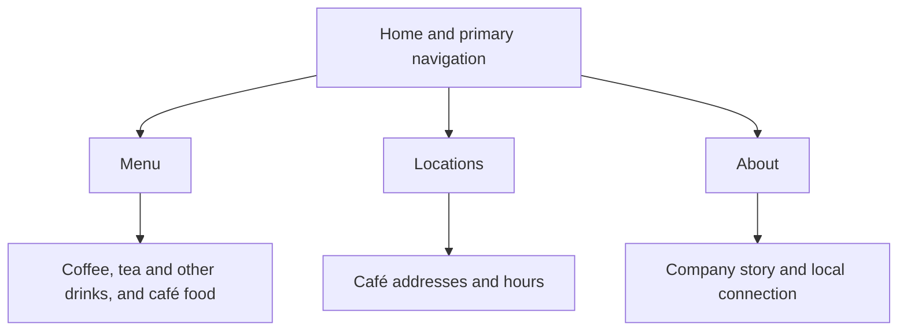

# Hill Country Coffee - Client Project Plan

**WebWorks Studio**  
**Week 13: Kick Off the Client Project - Discovery & Planning**  
**Student:** Jorge Martinez  
**Date:** November 11, 2026

## 1. Client & Project Summary

Hill Country Coffee is an independent Central Texas coffee company that serves coffee, tea, and a rotating selection of café food. The current website has grown unevenly, so customers can have trouble finding basic information, especially when they are looking at it on a phone. The new site is for local regulars checking hours on the go, first-time visitors planning a Hill Country trip, and people comparing food and drink options before meeting up. Our main job is to make hours, locations, and the menu easy to find and read on different screen sizes. The site should also give people a quick sense of the company’s neighborhood cafés and its connection to Central Texas. A small set of pages with clear labels and approved content will keep the site manageable for the rest of the project.

## 2. Prioritized Business Goals

| Priority | Goal | Why it matters | Evidence from the client brief |
|---|---|---|---|
| 1 | Help customers find café locations and hours quickly on a phone. | People need to know where to go and when a café is open before they leave. | The current site is hard to scan on a phone, and the client highlights mobile usability and visit information. |
| 2 | Help customers understand what drinks and food Hill Country Coffee offers. | Customers can decide if the café works for their plans. | The client wants an easy-to-scan menu and supplied three approved menu categories. |
| 3 | Give first-time visitors a clear sense of the business and its local connection. | Visitors can decide if the café is the kind of place they want to visit. | The brief asks the site to reflect the welcoming character of the cafés and their Central Texas roots. |

## 3. Target Users & User Needs

| Persona | Context | Primary goal and tasks | Likely friction | Design and accessibility implication |
|---|---|---|---|---|
| Maya, Mobile Regular | Local regular who usually checks from her phone while already out. | Confirm opening hours, find the closest café information, and check for a familiar item. | Buried hours, vague links, and long promotional copy. | Make Menu and Locations easy to reach and use readable text and touch-friendly links. |
| Daniel, Hill Country Visitor | First-time visitor planning a trip on a phone or laptop. May land on an interior page from search. | Find a café, check the general menu, and get a sense of the place. | Location details with little context, unclear navigation, and information trapped in images. | Keep navigation consistent and show important information as text on the relevant pages. |
| Renee, Deliberate Planner | Compares cafés before meeting friends. Uses phone or desktop and may enlarge text. | Browse food and drink categories and share useful information with a friend. | Small text, low contrast, image or PDF menus, and broken zoom layouts. | Use real text, descriptive headings and links, and layouts that reflow when enlarged. |

## 4. User-Need Statements

- Maya needs a way to check café hours and location details from her phone so that she can decide where to stop while she is already out.
- Daniel needs a way to see where the cafés are and understand what they offer so that he can decide if a stop fits his trip.
- Renee needs a way to review and share readable food and drink information so that she can choose a café with friends before they go.

## 5. Priority User Tasks

| Priority | User task | Primary personas | Why it matters |
|---|---|---|---|
| 1 | Find a café’s address and hours together. | Maya, Daniel | Helps people plan when and where to go. |
| 2 | Scan the menu by drinks and food categories. | Maya, Renee, Daniel | Helps visitors check what the café offers before going. |
| 3 | Understand what kind of café Hill Country Coffee is. | Daniel, Renee | Helps visitors decide if it suits their plans. |
| 4 | Reach the menu or locations from any page. | All three | Helps visitors who enter from search or a shared link. |
| 5 | Share a direct link to menu or visit information. | Renee | Lets friends see the same details when planning together. |

## 6. Content Inventory & Organization

| Content or section | Purpose | User task | Supplied | Missing or needed | Scope |
|---|---|---|---|---|---|
| Home | Introduce the café and point to the two most common tasks. | Understand the business, open Menu or Locations. | Approved company description, brand statement, and suggested action labels. | Final copy selection from approved material. | MVP |
| Menu | Show what is offered in scannable groups. | Browse coffee, tea, other drinks, and food. | Approved categories and item names. | Prices, full descriptions, and dietary or allergen details need approval if added. | Categories and approved items are MVP. Additional details depend on approval. |
| Locations | Keep visit details together for each café. | Find where to go and when it is open. | Instructor-approved placeholder details are expected during production. | Approved café names, addresses, and hours. | MVP |
| About | Explain the company’s story and Central Texas connection. | Decide if the café fits the kind of place the visitor wants. | Approved origin summary and values. | Final short copy selected from approved content. | MVP |
| Brand assets and photography | Support the brand and help show the café atmosphere. | Get a sense of the place. | Written brand direction and asset notes. | Logo and photos are pending. Confirm usage and credits if supplied. | Optional for the MVP. |

Keep drinks and food in one Menu page with category headings. Group each café’s address and hours under its name on Locations so visitors can read them together. Use Home for a short introduction and direct links to Menu and Locations. Put the fuller story and values on About.

## 7. Functional Requirements

1. The site must provide consistent Home, Menu, Locations, and About navigation on all four pages. Check each destination from each page.
2. The site must link directly from Home to Menu and Locations. Follow both links using a keyboard and a pointer.
3. The site must display approved items under Espresso & Coffee, Tea & Other Drinks, and Café Food as readable text. Compare the headings and items with the approved content.
4. The site must show the instructor-approved address and hours together for each listed café. Compare every entry with the approved location information.
5. The site must make Menu and Locations available through direct URLs. Open both URLs in a fresh browser window and confirm that the page and shared navigation work.
6. The site must keep the menu, location details, and navigation usable at narrow, medium, and wide widths. Repeat the main tasks at 375, 768, and 1280 pixels and check for clipped content or sideways scrolling.

## 8. Accessibility Requirements

| Area | Requirement |
|---|---|
| Semantic structure | Use a header, navigation, main content, and footer. Include a skip link to main content. |
| Heading structure | Use one descriptive main heading per page and nest section headings in logical order. |
| Keyboard access | Make links and any controls reachable and operable in a logical tab order. |
| Visible focus | Show a clear focus indicator on links and controls against each background. |
| Color contrast | Check text and interactive elements against the course accessibility standard. |
| Images and alternative text | Describe meaningful approved images in alt text and use empty alt text for decorative images. Keep menu and visit details as text. |
| Links and buttons | Use descriptive labels such as View the Menu. Use links for destinations and buttons for actions. |
| Responsive reflow and zoom | Check at 200% zoom and at a narrow viewport. Text, navigation, and location details must stay readable and usable. |
| Interactive components and forms | The MVP uses ordinary links and includes zero forms. If an optional control is approved, test its keyboard access, focus, and accessible name. |
| Accessibility QA | Check each page with a keyboard and an automated accessibility checker. Manually review headings, contrast, alt text, labels, and zoom. Record issues, fix them, and retest. |

## 9. MVP - Must Ship

- [ ] Home, Menu, Locations, and About with consistent navigation.
- [ ] Direct Home links to the approved menu categories and café visit information.
- [ ] Approved location details and hours together on Locations.
- [ ] A short company story and Central Texas connection using approved content.
- [ ] Responsive layouts, accessible content and navigation, and a working published site with source and handoff notes in GitHub.

Four informational pages cover the main tasks the personas share. The menu and location information can be maintained as text, and the team can build and test all four pages within the remaining sprints.

### Optional enhancements

| Idea | When it fits |
|---|---|
| Approved café photography | Add if approved files and credits are available in time. |
| Directions link for each café | Add if the client provides or approves the destination URLs. |

## 10. Future / Out of Scope

| Idea | Reason it is outside the course launch |
|---|---|
| Online ordering, payments, live inventory, and table reservations | The brief supplies no transaction requirements or approved systems. |
| Customer accounts and loyalty integration | There is no documented account task or loyalty workflow. |
| Newsletter signup and social media integrations | There is no approved platform, signup workflow, or integration requirement. |

## 11. Sitemap / Information Architecture

Primary navigation on each page includes Home, Menu, Locations, and About. The bottom row shows content sections within each page. Menu and Locations are easy to recognize for someone who comes from search, and the About page gives visitors a place to learn more about the company.

## 12. Technical Approach

| Area | Plan and reason |
|---|---|
| HTML | Use semantic HTML for four static pages. Real headings, links, and text make the information easier to scan and navigate. |
| CSS | Use one shared stylesheet with mobile-first rules, flexible widths, and media queries where the content needs them. This keeps spacing and text consistent across pages. |
| JavaScript | None planned for the MVP. The approved tasks are reading content and following links. |
| Libraries and components | Use native HTML and CSS. The scope can be built without a component library or CSS framework. |
| GitHub and deployment | Edit in VS Code and keep the source in the continuing public WebWorks Studio repository. Plan for GitHub Pages through the course workflow and confirm the publishing path in Week 14. Use relative links and test them on the published site. |
| Other options considered | React adds an application layer without a supported interactive task. A CMS could help if the client needs to edit content independently, but the brief does not establish that workflow. |

## 13. Production Milestones

| Milestone | What should be true | Key dependency |
|---|---|---|
| Production ready, Week 13 | The plan, sitemap, scope, and acceptance checks are ready for review. | Review of the supplied brief, personas, and approved content. |
| Core site built, Week 14 | Four responsive pages and shared navigation are substantially functional, with approved content in place as supplied. | Plan review, approved location details, and confirmed publishing path. |
| QA and refinement, Week 15 | Main tasks, links, mobile and desktop layouts, keyboard access, contrast, and zoom have been tested. Priority issues are fixed and retested. | Working build and approved content. |
| Delivery and portfolio, Week 16 | The final site and source links work, the README is current, and presentation and portfolio evidence are ready. | Verified release candidate and QA notes. |

## 14. Risks & Dependencies

| Risk or dependency | Impact | Likelihood | Response |
|---|---|---|---|
| Instructor-approved café addresses and hours arrive late. | High | Medium | Request the approved details at the start of Week 14 and track the missing entries before release. |
| Additional menu details are still unapproved. | Medium | High | Use the approved categories and item names. Ask which additional details are expected before adding them. |
| Approved logo or photos are unavailable. | Medium | Medium | Confirm availability and usage. Build the core pages around approved text and add approved imagery when available. |

## 15. Prioritized Sprint Backlog

| Task | Priority | Effort | Dependency | Status |
|---|---|---|---|---|
| Confirm approved visit details and ask about missing menu content and imagery. | High | Small | Instructor or client response | To Do |
| Confirm the course publishing path. | High | Small | Course workflow | To Do |
| Set up the shared page structure and navigation. | High | Medium | Reviewed sitemap | To Do |
| Build Home and About using approved copy. | High | Medium | Shared page structure and approved copy | To Do |
| Build Menu and Locations with approved information. | High | Medium | Menu content and approved location details | To Do |
| Apply shared responsive CSS and visible keyboard focus. | High | Medium | Working page structure | To Do |
| Publish the working build and test priority tasks, accessibility, and links. | High | Large | Functional pages and publishing access | To Do |
| Fix issues and retest on the published build. | High | Medium | QA findings | To Do |
| Finish the README, handoff, and portfolio evidence. | Medium | Medium | Verified final build | To Do |

## 16. Definition of Done

### Content

- [ ] All MVP content is present and proofread against the approved sources.
- [ ] Menu items, addresses, and hours match the approved materials.

### Responsive design

- [ ] All pages work at narrow, medium, and wide widths with no layout overflow.
- [ ] Menu groups, hours, and addresses remain readable and usable when zoomed.

### Functionality

- [ ] Shared navigation and Home links work on the published site.
- [ ] Direct links to Menu and Locations open correctly.

### Accessibility

- [ ] Landmarks, heading order, descriptive labels, keyboard access, and visible focus are checked.
- [ ] Contrast, alt text, and responsive reflow are checked.
- [ ] Any approved optional control passes keyboard and focus checks.

### QA

- [ ] All four pages are checked in a desktop browser and on a phone or phone emulator.
- [ ] Priority issues are fixed and retested. QA notes record the results.

### GitHub & handoff

- [ ] Current source is pushed to GitHub and the final public project link opens.
- [ ] The README links to the plan and explains where to update menu and location content.

## 17. Open Questions / Assumptions

1. When will the instructor provide the approved café names, addresses, and hours?
2. Should the final menu use the approved item names only, or will descriptions, prices, or dietary information be supplied?
3. Which logo and photo files will be approved for use, and do they need credits?

## Final Planning Check

- [x] Used the supplied brief, all three personas, approved content, and asset notes.
- [x] Prioritized three goals and five user tasks and wrote one need statement per persona.
- [x] Completed the content inventory, sitemap, functional requirements, and accessibility plan.
- [x] Defined MVP, optional enhancements, and future scope.
- [x] Justified the technology choices, mapped milestones, and wrote the backlog and Definition of Done.
- [x] Recorded risks and open questions. Week 13 work stops at planning.

