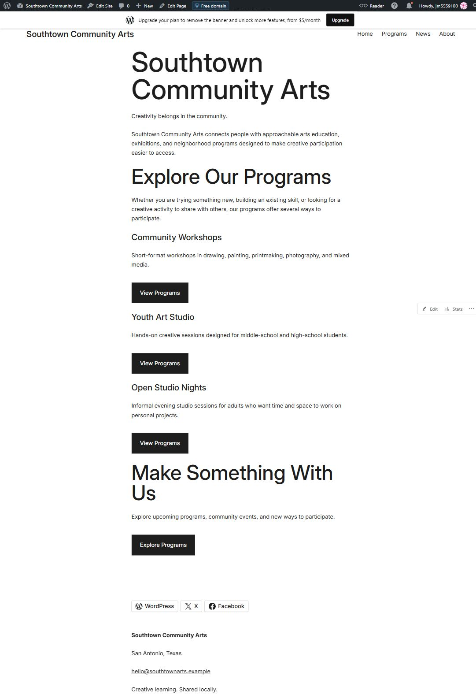
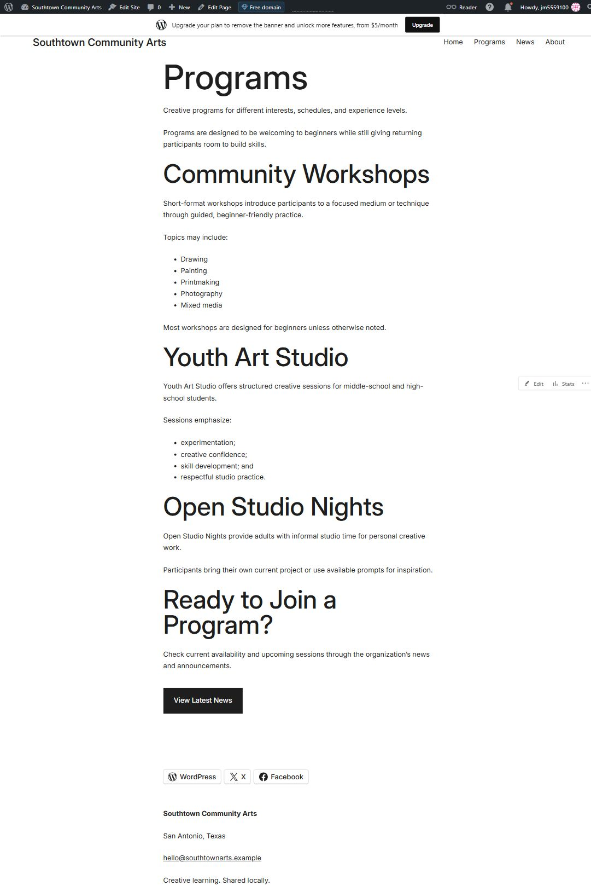
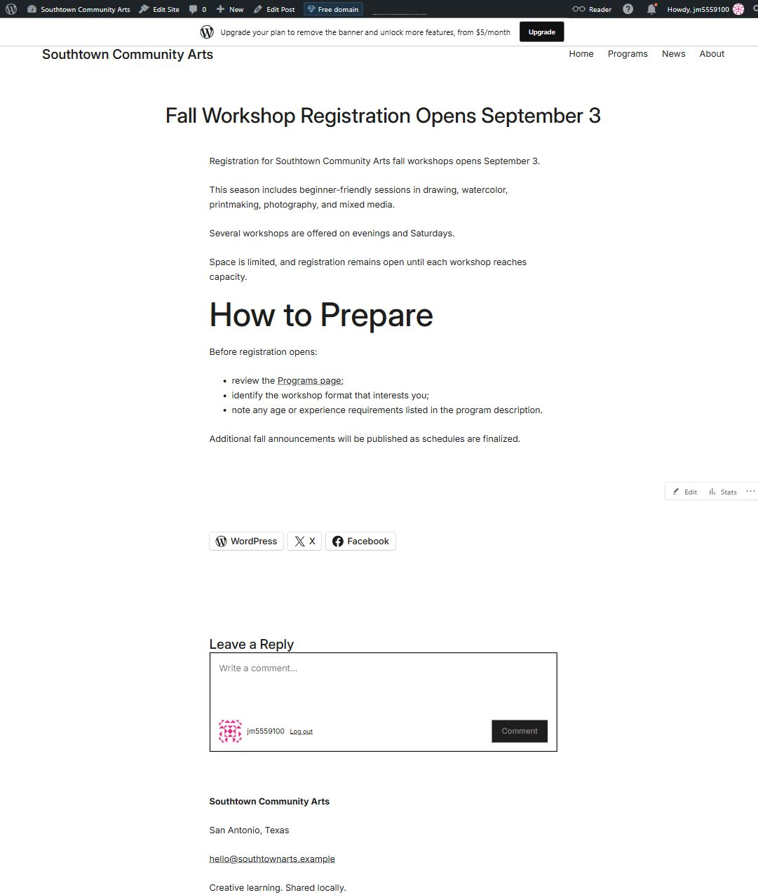
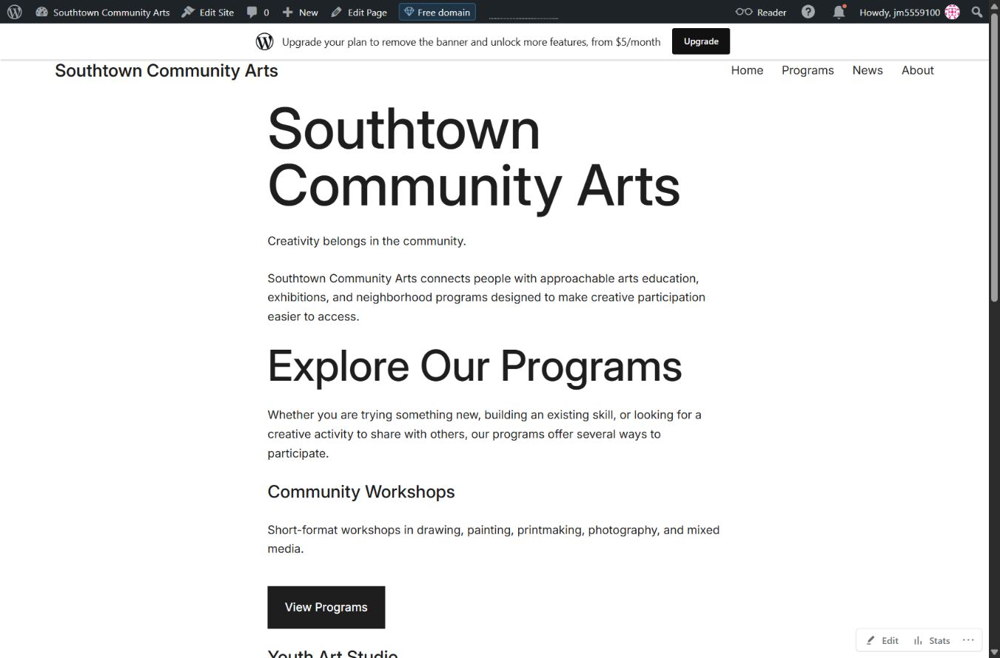
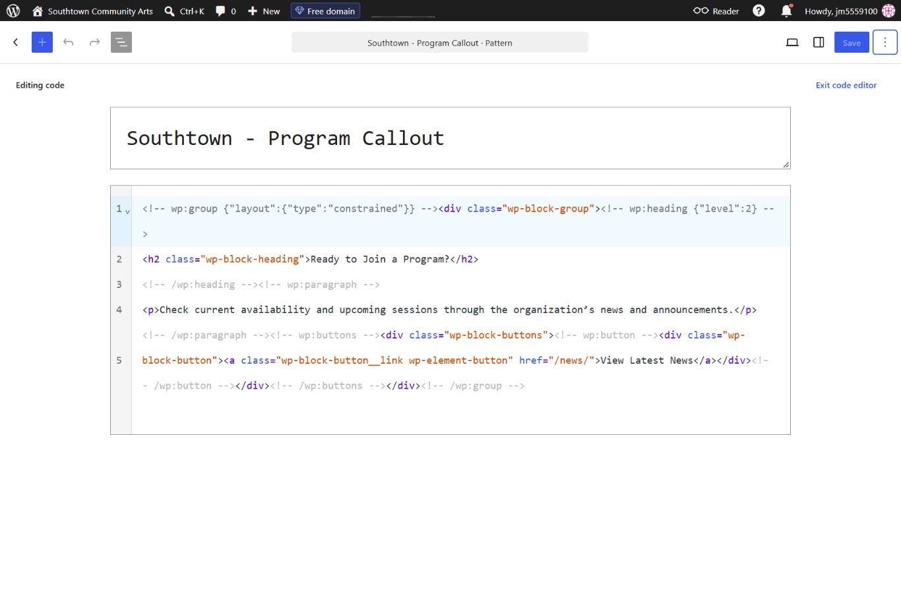
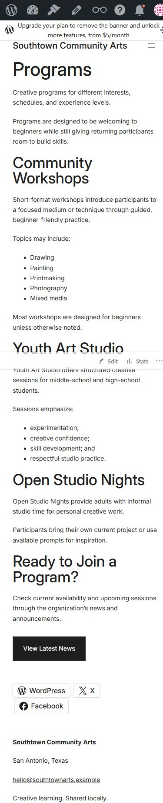

# Week 11: Build for Content — WordPress & CMS Fundamentals

## CMS Project Overview

**Client:** Southtown Community Arts  
**Role:** Junior Web / CMS Specialist

I configured a WordPress site using the supplied Southtown Community Arts content and the Assembler block theme. The site separates regular page content from shared navigation, the footer, and a reusable program callout so staff can make updates without rebuilding the layout.

## WordPress Site Access

**Live site:** https://jxrgieshouse.wordpress.com/  
**Platform:** WordPress.com Free  
**Theme:** Assembler

The front-end site is public. Editing requires the site owner's WordPress account; login information is not included in this repository.

## Content Architecture

### Pages

- **Home:** Introduces the organization and highlights its programs. It is stable information that visitors should always be able to find.
- **Programs:** Explains Community Workshops, Youth Art Studio, and Open Studio Nights. Staff can revise these descriptions as needed.
- **About:** Explains the organization's purpose and values. This belongs in the site's main information structure.
- **News:** Uses the native Latest Posts block to give visitors a place to find published announcements.

### Post

**Fall Workshop Registration Opens September 3** is a Post because it is a dated announcement that belongs in an ongoing news feed. The supplied announcement copy was preserved, including its September 3 date.

**Primary navigation:** Home → Programs → News → About.

## Reusable Pattern

**Pattern name:** Southtown - Program Callout

The synced pattern contains the “Ready to Join a Program?” heading, a short paragraph, and a “View Latest News” button. It is inserted on the Programs page. Saving these blocks together gives staff an approved callout they can reuse, and synced instances keep the same wording and structure.

Editors should understand that editing a synced pattern updates its other instances. Regular program descriptions remain outside the pattern so they can change independently.

## Site-Wide Structure

I updated the global Footer template part in the Site Editor with:

- Southtown Community Arts
- San Antonio, Texas
- hello@southtownarts.example
- Creative learning. Shared locally.

This information appears across the site, so keeping it in one shared footer makes future changes easier. The shared Header contains the required Navigation block. I also set the Single Posts template title to H1 so the announcement has a logical heading structure. These changes used WordPress's editors; no theme source files, PHP, custom CSS, or extra plugins were added.

## Client Update Test

### Supplied Update

After the main build, I changed the Community Workshops sentence from:

> Short-format workshops introduce participants to a specific medium or technique.

To:

> Short-format workshops introduce participants to a focused medium or technique through guided, beginner-friendly practice.

### Where I Made the Update

I selected and replaced the sentence inside the Programs page's existing Paragraph block through the page editor's code view. The existing block layout stayed in place.

### Structure Check

The sentence update did not change the header, footer, navigation, templates, template parts, or synced pattern. I checked the front-end Programs page afterward and confirmed the new wording and the same shared menu, footer, and callout.

### Maintainability Result

The program description is editable page content, so a normal text revision does not require a site-wide change. Keeping that text outside the shared pattern protects the other reusable content. The updated Programs page remained readable at desktop and phone widths.

## Accessibility & Responsive Checks

- **Headings:** Home, Programs, About, and the News post have H1 titles. Main sections use H2, with H3 for subsections such as the Home program highlights and About values.
- **Images:** The starter folder did not include content images, and none were added. Future informative images should receive useful alt text; decorative images should use empty alt text.
- **Links and buttons:** Navigation uses the required labels. Buttons use the supplied “View Programs,” “Explore Programs,” and “View Latest News” labels and lead to the matching destinations.
- **Keyboard:** Tab moved from Home to Programs in the primary navigation, with a visible outline. The mobile menu opened, focused its links, and allowed keyboard activation.
- **Responsive layout:** I checked the front-end Programs page at 1366 pixels and 390 pixels wide. Text wrapped within the screen, the navigation switched to a mobile menu, and there was no horizontal page overflow at the phone width.
- **Readability:** The theme's black text, white background, and clear button styling keep content easy to read without depending on color alone.

## Evidence

### Home Page

### Programs Page

### News Post

### Primary Navigation

### Reusable Pattern

### Narrow-Screen / Mobile View

## Developer Handoff

### CMS Choice

WordPress fits Southtown Community Arts because staff need to update program information and publish announcements regularly. They can manage that content through the dashboard instead of editing website files for every change.

### Editable Content

Staff should be able to revise program descriptions, About information, and announcements. They can also publish new Posts and maintain navigation as the site's content changes.

### Reusable Structure

The program callout is a synced pattern, while the header and footer are shared template parts. These structures keep repeated content consistent and reduce the amount of work needed to maintain the site.

### Client Protection

Program wording stays in page content, separate from the global layout and synced callout. For routine changes, staff should open the relevant Page or Post and leave the Site Editor alone. They should also check heading levels, link destinations, and mobile layout after editing.

## CMS vs. Coded Site Reflection

A CMS works well for organizations that regularly update programs, announcements, or other information and have staff who do not write code. WordPress makes those changes easier because editors can manage pages and posts through a dashboard. Patterns and shared template parts also help the site stay consistent. Compared with a hand-coded static site, though, a CMS adds more settings, maintenance, and opportunities for editing mistakes. A small site that rarely changes might be easier to manage as static files. For Southtown, the regular content updates make a CMS a practical choice.

## Final Handoff Check

- [x] Home, Programs, and About are published as Pages.
- [x] The supplied announcement is published as a Post.
- [x] Primary navigation works in the required order.
- [x] The reusable pattern is saved and used on Programs.
- [x] The required global footer adjustment is complete.
- [x] The client update was completed after the main build.
- [x] The sentence update left shared structures intact.
- [x] Headings and link labels were checked.
- [x] Keyboard focus and mobile navigation were checked.
- [x] Desktop and narrow Programs layouts were checked.
- [x] Six evidence screenshots are saved in this folder.
- [x] Developer handoff responses and the CMS reflection are complete.
- [ ] GitHub push and online screenshot display verified.
- [ ] Direct Week 11 folder link submitted in Canvas.
