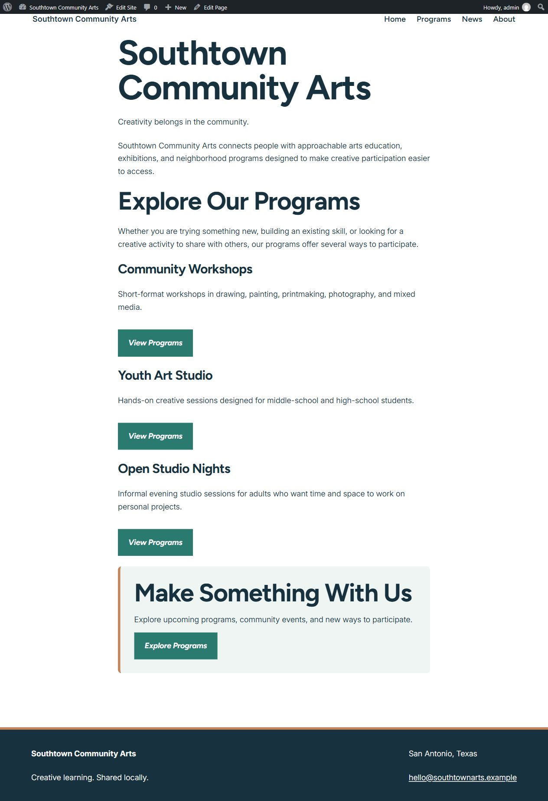
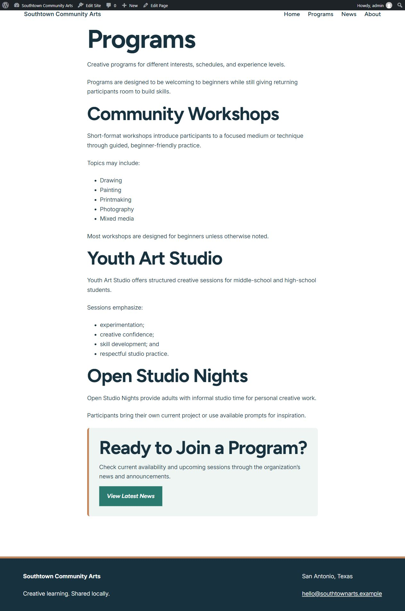
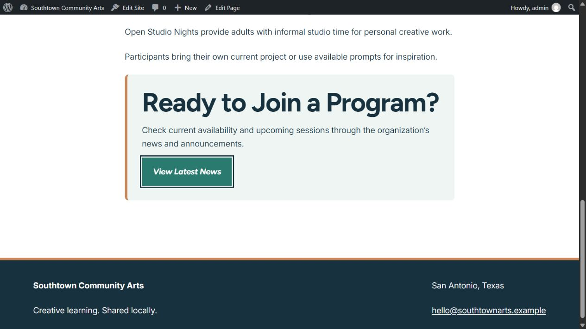
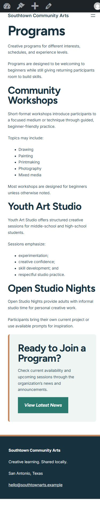
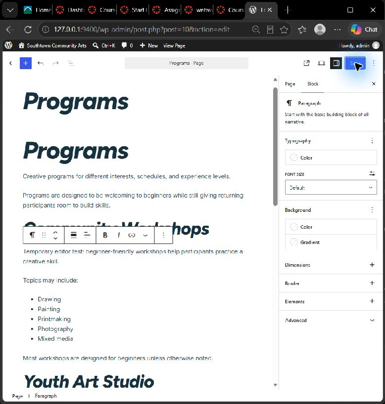

# Week 12: Customize the Experience — WordPress Development

**Client:** Southtown Community Arts  
**Role:** Junior WordPress Developer

## Project Overview

I continued the Week 11 Southtown site by exporting its existing content and importing it into local WordPress with the same Assembler theme. I customized the global colors, typography, buttons, reusable callout, and shared footer while keeping regular content editable in WordPress.

**Local site:** http://127.0.0.1:9400/  
**Local editor:** http://127.0.0.1:9400/wp-admin/  
**Week 11 public site:** https://jxrgieshouse.wordpress.com/

The local server must be running to open the local links. The public Week 11 site does not display these local Week 12 changes. WordPress.com Free blocked the required global styles and CSS, so the existing CMS was migrated locally. Acceptance of this environment instead of the stated instructor-supplied environment still needs instructor confirmation.

# Customization Decisions

## 1. Global Design System

**Requirement:** Use the approved Southtown palette, clear sans-serif typography, identifiable actions, and consistent spacing/layout across the site.

**Location:** Site Editor → Styles, stored as WordPress Global Styles.

**Change:** Updated the existing palette presets to Paper `#ffffff`, Soft `#eef5f3`, Warm `#c7855a`, Deep `#17313f`, and Teal `#2b7a70`. Used Figtree bold upright headings with 1.15 line height and Inter body text at 18px with 1.65 line height. Set the content width to 720px and wide width to 1120px. Primary buttons use white text on teal. Retained the theme's fluid sizing and page gutters.

**Why this level:** These decisions apply throughout the site. A global update keeps pages consistent and avoids repeating the same styling on every page.

**QA:** Checked Home, Programs, About, and News at desktop width, and Home and Programs at 390px phone width. Confirmed no horizontal overflow. Actual contrast ratios are Deep/Paper 13.57:1, Deep/Soft 12.27:1, and Paper/Teal 5.10:1. Warm is a decorative border accent, not small text on white.

## 2. Branded Reusable Pattern

**Pattern:** Southtown - Program Callout, continued from Week 11.

**Change:** Added a soft surface, deep text, a warm left border, rounded corners, internal spacing, and a teal CTA using native Group and Button block settings.

**Reuse:** The Programs page uses the synced pattern with “Ready to Join a Program?” and “View Latest News.” Home uses a detached copy of the same block structure with its original “Make Something With Us” heading, supporting sentence, and “Explore Programs” CTA. This verifies different content within the same branded structure without rewriting approved copy.

**Editor value:** Staff can reuse the layout and replace its content. Changes to the synced Programs pattern affect its synced instances. The detached Home version can be edited independently; later structural updates must also be applied to that detached instance.

## 3. Site-Wide Structure Customization

**Shared area:** Footer template part in the Site Editor.

**Change:** Reorganized the existing footer into a wrapped identity group and contact group. Applied a Deep background, white text and underlined email link, a Warm top border, and consistent padding. Preserved the organization name, San Antonio location, email, and tagline.

**Why this level:** Every page uses this footer. Editing the shared template part updates it across the site.

**QA:** Verified the shared footer on Home, Programs, About, and News, including narrow layouts. The groups wrap instead of forcing a fixed-width row. White text on Deep has 13.57:1 contrast.

## 4. Controlled Development-Level Modification

**Option used:** One targeted CSS rule.

**Location:** Site Editor → Styles → More → Additional CSS. The rule is added after the theme's existing CSS. The original Assembler theme.json was not edited; its file hash matches the downloaded original.

```css
/* Southtown: visible keyboard focus on light and dark surfaces. */
:root :is(a, button, input, textarea, select):focus-visible {
  outline: 3px solid #17313f;
  outline-offset: 3px;
  box-shadow: 0 0 0 6px #ffffff;
}
```

**Reason:** The normal global controls do not expose a consistent two-color keyboard-focus ring for links, buttons, and form controls. The dark outline and white outer ring keep focus noticeable against both light content and the dark footer. The selector also gives the rule enough priority to override the theme's existing button focus treatment without using !important.

**Documentation:** [WordPress Styles overview](https://wordpress.org/documentation/article/styles-overview/) and [WordPress CSS guidance](https://developer.wordpress.org/advanced-administration/wordpress/css/).

**QA:** Tabbed through links and the mobile navigation, opened the menu with Enter, verified focus moved into it, and closed it with Escape. Checked the CTA's computed outline and white outer ring. No second CSS customization, theme.json edit, child theme, custom plugin, or PHP theme change was added.

# Visitor + Editor QA

## Visitor Experience

- [x] Tested narrow and wide viewport behavior.
- [x] Checked visual consistency on more than one page.
- [x] Checked text/link/button contrast.
- [x] Verified visible keyboard focus.
- [x] Tested navigation and links.
- [x] Checked that the brand system is global rather than page-specific.

### Visitor QA Notes

The typography preset initially used italic headings. I changed all headings to upright Bold through Global Styles for a clearer reading hierarchy. Home and Programs fit a 390px viewport without horizontal overflow, and the callout and footer remain readable. The mobile menu opens with Enter, supports Tab navigation, and closes with Escape. The installation's disposable Sample Page and Hello world post were moved to Trash; the approved client pages and announcement were preserved.

## Editor Experience

- [x] Routine content is still editable through WordPress.
- [x] The branded pattern remains available for reuse/editing.
- [x] Ordinary client content remains outside code and global settings.
- [x] Performed a temporary routine content edit, checked the front end, and restored the original.
- [x] The site remained visually coherent after the editor test.

### Editor QA Notes

In Edge's visual block editor, I temporarily replaced the Community Workshops sentence with “Temporary editor test: beginner-friendly workshops help participants practice a creative skill.” I saved it and verified the changed text on the front end while the branded callout and footer remained intact. I then restored and saved this exact approved sentence:

> Short-format workshops introduce participants to a focused medium or technique through guided, beginner-friendly practice.

A front-end reload confirmed that the approved sentence was restored and the temporary text was removed. This test used normal text editing, not code or global settings. The in-app browser did not render the visual editing canvas correctly, so the editor-side test was completed in Edge.

# Evidence

## Customized Home


## Customized Programs


## Branded Reusable Pattern


## Responsive / Mobile View


## Editor Maintainability Test


# Maintainability Reflection

I handled the colors, fonts, buttons, and content widths globally because those choices should stay consistent across the site. I left program descriptions as editable page content so staff can update information without changing the design system. For example, the Community Workshops sentence can be changed in the normal block editor while the typography and spacing stay in place. The reusable callout gives staff an established layout, and the shared footer keeps contact information consistent. This separation makes routine updates easier while reducing the chance of accidentally changing the site's overall appearance.

# Final Handoff Check

- [x] Continued the existing Week 11 Southtown content through a CMS migration.
- [x] Applied the approved palette and typography direction systematically.
- [x] Used Global Styles for global decisions.
- [x] Customized the existing branded pattern and reused its structure in two contexts.
- [x] Refined one shared site-wide structure.
- [x] Completed exactly one controlled development-level CSS modification.
- [x] Kept the original theme.json and theme source unchanged.
- [x] Completed visitor and editor QA.
- [x] Captured all five required evidence screenshots.
- [x] Completed the maintainability reflection.
- [ ] Confirmed instructor acceptance of the local environment.
- [x] Placed the finished folder in the existing repository.
- [ ] Committed and pushed the Week 12 folder.
- [ ] Verified this README and images on GitHub.
- [ ] Submitted the direct Week 12 GitHub folder link in Canvas.
